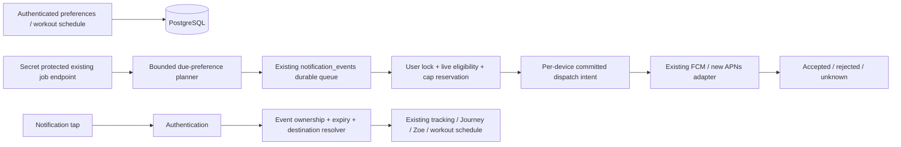

# Zoe Smart Nudges V1 — architecture

## Flow

## Policy

- Default off, no inserted preferences at migration. Rollout modes off/development/internal/pilot/all; internal and pilot require explicit user-ID allowlists. Independently enabled categories. Global off stops dispatch even for previously queued jobs.
- Saved per-account IANA timezone; category schedules, quiet hours, weekly day, comeback threshold, Minimal/Balanced/Supportive. Minimal permits only explicitly enabled meals, hydration and scheduled workouts. Balanced/Supportive permit 2/3 routine coaching messages. Overall cap 4/day AND 4/rolling 24 hours, maximum 2 workout alerts/day; 90-minute separation. Cap reservations include unknown outcomes. Routine category at most once/local day. Retry uses the same reservation.
- Priority: scheduled workout, meal/hydration, weekly, morning/evening, comeback, milestone. Due work is selected by priority. Simultaneous lower-priority work is suppressed by cooldown. No burst of catch-up after downtime.
- Planner materializes near-future occurrences with unique keys. Missing DST wall times are skipped, repeated wall times resolve once. Worker uses due/expiry indexes and bounded batches, no browser timer or one timer per user.
- User-level advisory transaction lock serializes cap reservations and preference/schedule mutations. Recheck consent/version, rollout, permission registration, quiet hours, completion and relevance before every provider call. In-flight provider calls cannot be recalled; this race is explicitly bounded to a single already-started request.
- Durable device states distinguish queued, dispatched, accepted, retryable rejection, failed, unknown. Only definite provider rejection is retryable, with bounded exponential backoff. Timeout/crash after dispatch intent is unknown and terminal; accepted devices are never retried. Account deletion cascades, disabled/reassigned tokens are checked again before dispatch.
- Legacy discretionary coaching is excluded for accounts with saved nudge preferences, including master-off accounts. Direct human trainer updates remain the existing separate channel; master control is labelled for Zoe nudges. Essential security/account messages are outside the system.

## Data and destinations

Existing `notification_events` is the queue and occurrence ledger. Add preferences (JSON validated by shared schema), per-device deliveries and small state transitions with reason codes. Use an explicit workout appointment table because no timed scheduler exists. No AI generation, HealthKit data, copied trainer text or sensitive statistics in push payloads. Payload contains only an opaque event ID and a safe resolver URL.

Meal completion checks `logged_at` in the chosen local day/category, even when the entry was added later. Water checks recent recorded logs. Workout appointments are authoritative for time/status; user can edit, cancel, mark done or link a manual workout log. Weekly opens `/journey` (existing authenticated recorded progress); no invented weekly narrative. Milestones are first/tenth/twenty-fifth recorded `burn_log` after consent, excluding HealthKit import data; dedupe survives ordinary event retention. Comeback uses app-open evidence and consent time, at most three attempts per absence, at least seven days apart; return resets the episode. Missing app use never implies missing exercise.

Links resolve through `/notifications/open?id=UUID`, with server-side user ownership, age and entity checks. Unknown/deleted/expired links safely fall back. Legacy links are restricted to existing same-origin routes. Login carries only an opaque ID, never a destination supplied by a caller. Opens are recorded only for events belonging to the authenticated user. No decorative action buttons or snooze in V1.

## Growth and cost

Indexed `next_plan_at` avoids rescanning every user every minute. Batches and per-user locks bound load; provider calls release DB connections. Near-future materialization is O(enabled categories), no AI cost. PostgreSQL writes/storage and provider requests are the costs; no price assumption or invented forecast. At 100k users, tune planner/dispatch batch budgets, partition/retain old transitions, observe lag, and add workers with the same lock contract before considering an external queue. Adaptive timing is a future, separately consented version; V1 never changes user-selected times automatically.
